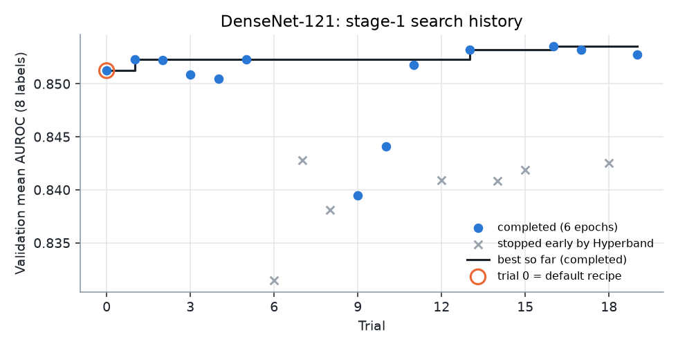
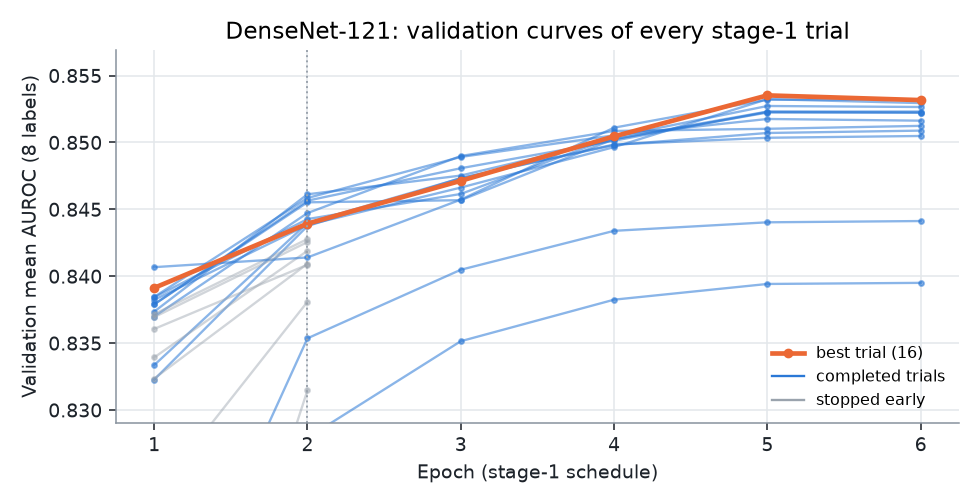
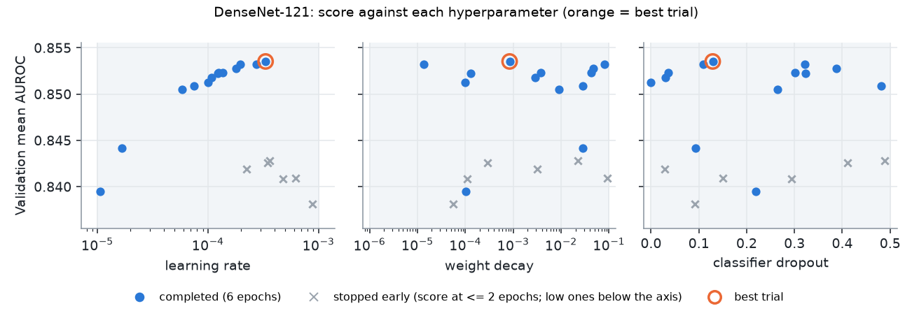
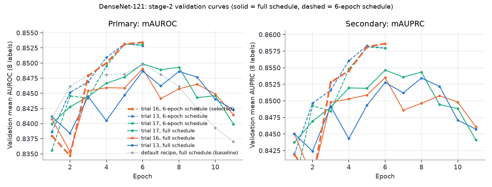
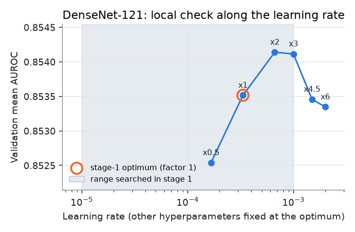
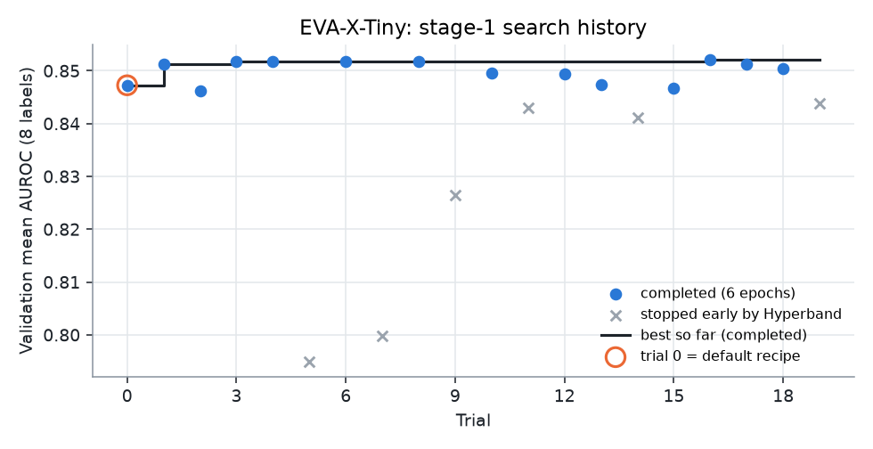
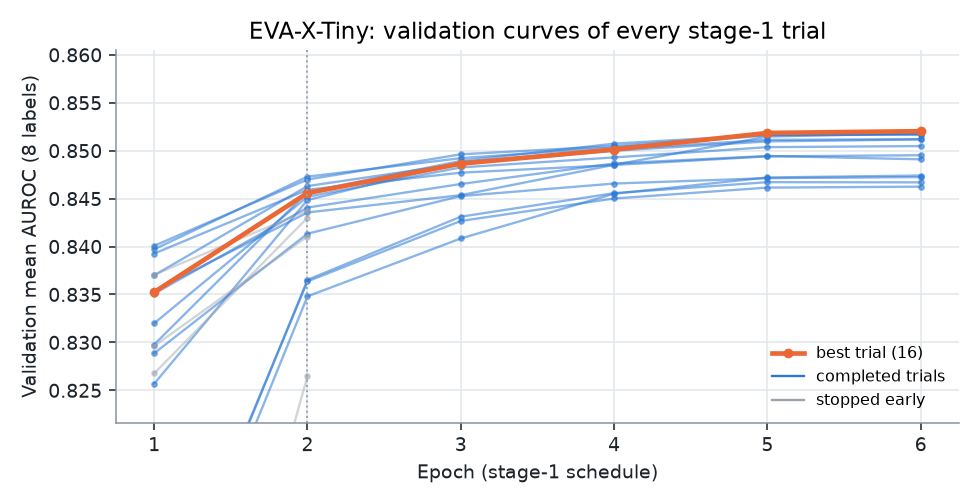
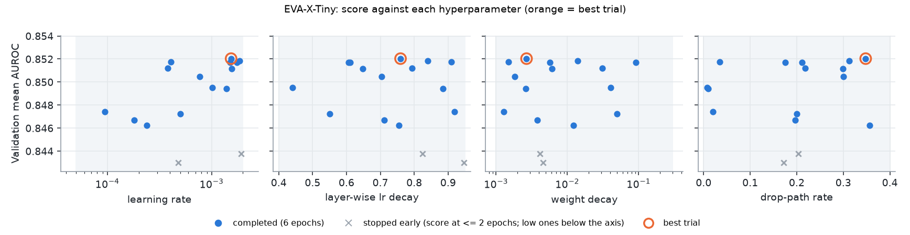
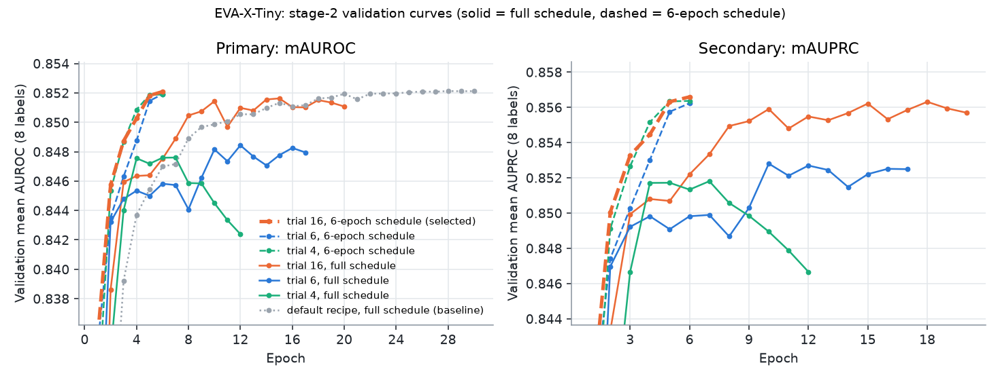
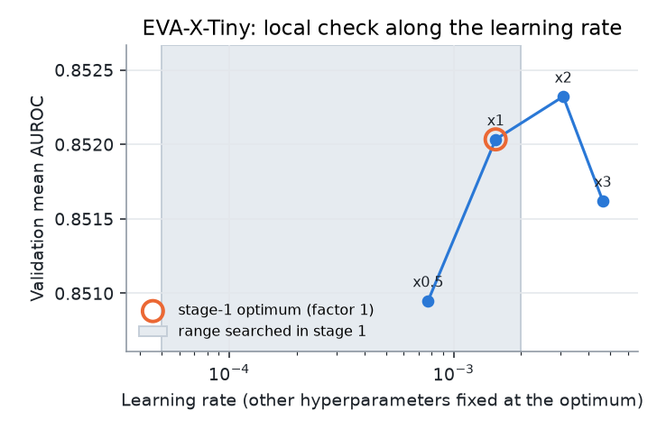

# Hyperparameter Optimisation — DenseNet-121 and EVA-X-Tiny

How the hyperparameters of both models were searched: what the search space is and why, which search
strategy we used and why, and how we checked that the search found the optimum. Run on one RTX 5090 on
2026-11-24/25, about 9 GPU-hours in total. Everything here uses the **validation** split only. The test
split played no part in any choice.

- **Primary metric:** mean AUROC over the 8 labels (validation). This is what the search maximises.
- **Secondary metric:** mean AUPRC (average precision) over the 8 labels. It is recorded for every trial and
  every epoch, but not optimised. Its chance level is the share of positives, which here is 33–70% per
  label, so it complements AUROC by showing how clean the top-ranked positives are.

## Summary

| | DenseNet-121 | EVA-X-Tiny |
|---|---|---|
| Search space | lr, weight decay, classifier dropout (3-D) | lr, layer-wise lr decay, weight decay, drop path (4-D) |
| Strategy | TPE Bayesian optimisation + Hyperband (multi-fidelity), then full-fidelity confirmation, then a local check along the most important hyperparameter | same |
| Stage-1 trials | 20 (13 completed, 7 stopped early), 92 epochs | 20 (14 completed, 6 stopped early), 96 epochs |
| Most important hyperparameter (fANOVA) | learning rate (92%) | learning rate (56%), then drop path (34%) |
| **Final configuration** | lr **6.7e-4**, weight decay 8.4e-4, dropout 0.13, **6-epoch schedule** | lr **3.1e-3**, layer decay 0.76, weight decay 0.0027, drop path 0.35, **6-epoch schedule** |
| Validation mAUROC: default recipe → tuned | 0.8498 → **0.8541** (+0.0043) | 0.8521 → **0.8523** (+0.0002) |
| Validation mAUPRC: default recipe → tuned | 0.8540 → **0.8592** | 0.8566 → **0.8567** |
| Training time of the final model | 9.3 min (was 19.5 min) | 7.2 min (was 42.6 min) |

The **validation curves of every trial** (the "validation accuracy graph") are in section 3, figures
`*_curves.png`.

Tuning mattered for DenseNet-121 and hardly at all for EVA-X-Tiny, whose published recipe was already near
its optimum. On the test set this reverses the earlier comparison; see section 6 and
[Results](../evaluation/README_RESULTS.md).

## 1. Search space, and why

### What stays fixed

The project compares chest-X-ray pretraining with ImageNet pretraining, so both models must see the same
data. These settings are **shared and fixed**, not searched:

| Fixed setting | Value | Why it is not searched |
|---|---|---|
| Labels | 8 outputs, positive when grade ≥ 2 | A task definition, not a model hyperparameter; changing it changes the question. |
| Input size | 224 × 224, zero-padded to a square | The resolution EVA-X-Tiny was pretrained at (14 × 14 patches of 16 px). |
| Augmentation | Rotation ±10°, shift ±5%, zoom 0.9–1.1, no flip | Must be identical for both models. Flips are excluded because the labels are left/right specific. |
| Batch size | DenseNet-121: 128; EVA-X-Tiny: 512 | Batch size and learning rate are largely interchangeable (linear scaling rule), so we fix the batch for throughput and search the learning rate. |
| Optimizer and schedule shape | AdamW, linear warmup, cosine decay | Standard for fine-tuning both CNNs and ViTs. The schedule's *length* is the fidelity (section 2) and turned out to matter (section 5). |
| Seed | 0 | One run per configuration; see limitations. |

### DenseNet-121 (3 dimensions)

The first DenseNet-121 run overfit after epoch 6: validation loss rose while training loss kept falling.
So besides the learning rate, the space covers the two regularisers that act on a pretrained CNN.

| Hyperparameter | Range | Scale | Default | Why this range |
|---|---|---|---|---|
| Learning rate | 1e-5 to 1e-3 | log | 1e-4 | Fine-tuning a pretrained CNN with AdamW works between about 1e-5 (too slow to adapt) and 1e-3 (destroys pretrained features). The default sits in the middle on a log scale. |
| Weight decay | 1e-6 to 1e-1 | log | 1e-4 | From effectively off to strong. AdamW decay is decoupled from the gradient step, so it is searched independently of the learning rate. |
| Classifier dropout | 0 to 0.5 | linear | 0 | Dropout on the 1024 pooled features before the new 8-way head. Above 0.5 the head loses too much signal. |

### EVA-X-Tiny (4 dimensions)

These are the four knobs the EVA-X authors tune when fine-tuning EVA-X. The ranges are centred on their
published ChestX-ray14 recipe.

| Hyperparameter | Range | Scale | Default (authors) | Why this range |
|---|---|---|---|---|
| Learning rate (batch 512) | 5e-5 to 2e-3 | log | 5e-4 | The authors' 1e-3 at batch 1024 is 5e-4 at batch 512. The range spans 10× below to 4× above it. |
| Layer-wise lr decay | 0.40 to 0.95 | linear | 0.55 | Each earlier transformer block learns `decay` times slower than the next. Low values keep the pretrained early blocks almost frozen; 0.95 fine-tunes all blocks nearly equally. |
| Weight decay | 1e-3 to 0.3 | log | 0.05 | ViT fine-tuning typically uses 0.05; the range covers 50× lower to 6× higher. |
| Drop-path rate | 0 to 0.4 | linear | 0.2 | Stochastic depth, the main regulariser for ViTs. Above 0.4 a 12-block tiny model drops too much. |

Log scales are used where a hyperparameter acts multiplicatively (learning rate, weight decay), so the
search spends as much effort between 1e-5 and 1e-4 as between 1e-4 and 1e-3.

## 2. Search strategy, and why

**Bayesian optimisation (TPE) with multi-fidelity Hyperband (the BOHB idea), followed by a full-fidelity
confirmation and a local check. Together this is a hierarchical, coarse-to-fine search.** It is
implemented in `scripts/hpo.py` with Optuna.

### Why not grid or random search

- **Grid search** scales exponentially: 5 values per dimension is 125 runs for DenseNet-121 and 625 for
  EVA-X-Tiny. It also tests only those 5 values of each hyperparameter, even though here one hyperparameter
  (the learning rate) matters far more than the others (Bergstra and Bengio, 2012).
- **Random search** tries every dimension at many distinct values and is a strong baseline, but it does
  not learn from earlier trials. With an expensive objective and about 20 trials per model, that wastes
  budget.
- **Bayesian optimisation** models which regions score well and samples there more often. We use the
  **Tree-structured Parzen Estimator (TPE)**, with the multivariate option so it can model interactions such
  as learning rate × layer decay. TPE handles log-scale and bounded continuous parameters natively and also
  learns from trials that were stopped early. The first 8 trials are random (TPE's warm-up); TPE proposes
  the remaining 12. Trial 0 is the default recipe, so the search must beat a known configuration.

### Why multi-fidelity

A full training run takes 20–45 minutes, so 20 full runs per model would take about 25 GPU-hours. Most of
that can be saved because learning curves separate good and bad configurations early.

- **Fidelity = training length.** Each stage-1 trial trains a *complete* short schedule of **6 epochs**
  (1 warmup epoch, then cosine decay to zero), so the learning rate still anneals within the trial.
- **Hyperband pruning** (Li et al., 2018), with reduction factor 3 and minimum resource 2 epochs. In the
  aggressive bracket, a trial stops after epoch 2 unless it is in the top third at that point. In the
  conservative bracket, trials always run all 6 epochs.
- **TPE + Hyperband** is the BOHB idea (Falkner et al., 2018): the sampler decides *where* to look, and the
  scheduler decides *how long* to look at each point.

### The three stages

| Stage | What runs | Purpose |
|---|---|---|
| 1. Global search (`hpo.py search`) | 20 TPE trials per model on the 6-epoch schedule, with Hyperband | Explore the whole space cheaply |
| 2. Confirmation (`hpo.py refine`) | The **top 3** stage-1 configurations, each retrained on the 6-epoch schedule *and* on the model's full schedule (DenseNet-121 20, EVA-X-Tiny 30 epochs, early stopping) | Check the ranking holds, and choose the schedule length |
| 3. Local check (`hpo.py local`) | The best configuration with only the learning rate (the most important dimension) multiplied by ×0.5 to ×6, without pruning | Check that the optimum is a real peak, and correct it if not |

The final configuration is the run with the highest validation mean AUROC across stages 2 and 3.

## 3. Results

### DenseNet-121

**Search history.** Best-so-far climbs from the default recipe (trial 0, 0.8512) to 0.8535 (trial 16)
and is flat over the last 3 trials.



**Validation curves of every stage-1 trial** (validation mAUROC per epoch). Grey curves were stopped by
Hyperband after epoch 2; the dotted line marks that decision point.



**Score against each hyperparameter.** The learning rate dominates (fANOVA importance 92%); weight decay
and dropout barely matter once the learning rate is right.



**Stage 2: both schedule lengths for the top 3 configurations.**

| Stage-1 trial | lr | weight decay | dropout | Stage 1 | 6-epoch rerun | Full schedule (20 ep.) |
|---|---|---|---|---|---|---|
| 16 | 3.3e-4 | 8.4e-4 | 0.13 | 0.8535 | **0.8534** | 0.8491 (peak at epoch 6) |
| 13 | 2.0e-4 | 0.080 | 0.32 | 0.8532 | 0.8532 | 0.8486 (peak at epoch 6) |
| 17 | 2.7e-4 | 1.3e-5 | 0.11 | 0.8532 | 0.8531 | 0.8499 (peak at epoch 6) |



**Stage 3: local check along the learning rate.** The best score is at ×2 (6.7e-4), not at the stage-1
optimum, with ×3 tied. Scores fall on both sides, so the peak is bracketed.

| lr factor | ×0.5 | ×1 (stage 1) | **×2** | ×3 | ×4.5 | ×6 |
|---|---|---|---|---|---|---|
| Learning rate | 1.7e-4 | 3.3e-4 | **6.7e-4** | 1.0e-3 | 1.5e-3 | 2.0e-3 |
| Val mAUROC | 0.8525 | 0.8535 | **0.8541** | 0.8541 | 0.8535 | 0.8534 |
| Val mAUPRC | 0.8577 | 0.8582 | **0.8592** | 0.8590 | 0.8587 | 0.8583 |



### EVA-X-Tiny

**Search history.** Best-so-far climbs from the authors' recipe (trial 0, 0.8472 on the 6-epoch schedule)
to 0.8520 (trial 16). From trial 3 on, the best values all lie within 0.0004 of each other: the landscape
near the top is flat.



**Validation curves of every stage-1 trial.**



**Score against each hyperparameter.** The learning rate (56%) and drop path (34%) matter; layer decay
(9%) and weight decay (under 1%) much less. Good trials span layer decay 0.6–0.9 and weight decay
1e-3–1e-1.



**Stage 2.**

| Stage-1 trial | lr | layer decay | weight decay | drop path | Stage 1 | 6-epoch rerun | Full schedule (30 ep.) |
|---|---|---|---|---|---|---|---|
| 16 | 1.5e-3 | 0.76 | 0.0027 | 0.35 | 0.8520 | **0.8521** | 0.8516 (peak at epoch 15) |
| 6 | 1.8e-3 | 0.84 | 0.014 | 0.31 | 0.8518 | 0.8519 | 0.8484 (peak at epoch 12) |
| 4 | 4.1e-4 | 0.91 | 0.0015 | 0.03 | 0.8517 | 0.8519 | 0.8476 (peak at epoch 7) |



**Stage 3: local check along the learning rate.** The best score is at ×2 (3.1e-3, just above the
searched range), and it falls again at ×3, so the peak is bracketed. The gain over ×1 (+0.0003) is within
noise.

| lr factor | ×0.5 | ×1 (stage 1) | **×2** | ×3 |
|---|---|---|---|---|
| Learning rate | 7.7e-4 | 1.5e-3 | **3.1e-3** | 4.6e-3 |
| Val mAUROC | 0.8510 | 0.8520 | **0.8523** | 0.8516 |
| Val mAUPRC | 0.8553 | 0.8565 | **0.8567** | 0.8561 |



## 4. Did we find the optimum?

| Check | DenseNet-121 | EVA-X-Tiny |
|---|---|---|
| Search history flattens | Yes: no gain in the last 3 trials | Yes: best within 0.0004 from trial 3 on |
| Best stage-1 values inside the ranges (automatic check, 5% margin) | Yes, all 3 | Yes, all 4 |
| Stage-1 ranking holds at stage 2 (Spearman, best stage-2 run per config) | 1.0 | 1.0 |
| 6-epoch reruns reproduce stage 1 (same seed) | Within 0.0001 | Within 0.0002 |
| Peak bracketed along the most important dimension | Yes: rises to ×2–×3, falls from ×4.5 | Yes: rises to ×2, falls at ×3 |

**Yes, with one correction.** The global search placed DenseNet-121's learning rate too low (3.3e-4 instead
of about 6.7e-4). Stage 3 caught and corrected this. The cause is explained in the next section.

## 5. What we learned about the search itself

1. **Hyperband was biased against high learning rates (short-horizon bias).** All five DenseNet-121
   trials above 3.3e-4 were stopped after epoch 2: high-learning-rate runs start slower but finish better,
   so they look weak at the first checkpoint. This is a known failure mode of multi-fidelity methods. The
   local check in stage 3 exists to catch it, and it did.
2. **Schedule length is itself a hyperparameter here.** For every tuned configuration of both models, the
   short 6-epoch schedule beat the long one by 0.0005–0.0046. With a long cosine schedule the learning
   rate stays high for many epochs, and the models overfit before it decays. All six full-schedule runs
   peaked early (epochs 6–15) and then declined. So stage 2 compares both lengths, instead of treating
   "full" as the gold standard.
3. **EVA-X-Tiny's landscape is flat near the top.** Many different configurations land within about
   ±0.0005, so tuning brings little for EVA-X-Tiny beyond much cheaper training (7 instead of 43 minutes).
   The authors' recipe was already close to optimal. DenseNet-121's default (lr 1e-4) was clearly too low.

## 6. Test results after tuning

The final configurations were then evaluated once on the test split (42,928 images, 9,545 patients).
Selection used validation only.

| Test set | DenseNet-121 | EVA-X-Tiny | Difference (EVA-X minus DenseNet) |
|---|---|---|---|
| mAUROC, default recipes | 0.848 | 0.850 | +0.003 (95% CI +0.002 to +0.003) |
| **mAUROC, tuned** | **0.852** | 0.850 | **−0.002** (−0.002 to −0.001), p < 0.001 |
| mAUPRC, default recipes | 0.853 | 0.857 | +0.003 (+0.002 to +0.004) |
| **mAUPRC, tuned** | **0.858** | 0.856 | **−0.002** (−0.003 to −0.001), p < 0.001 |

Full tables and interpretation: [Results](../evaluation/README_RESULTS.md).

## Limitations

- **One seed per configuration.** The 6-epoch reruns used the same seed, so they measure GPU nondeterminism
  (≤ 0.0002), not seed-to-seed variation. Differences under about 0.001 between configurations should be
  read as ties.
- **Stage 3 varies only the learning rate.** The other hyperparameters keep their stage-1 values. A joint
  re-search around the new learning rate could gain a little more.
- **20 trials per model** is a modest budget. Search history and importance suggest it was enough for these
  3–4 dimensions, but not for a larger space.

## Reproduce

```bash
PY=python bash scripts/run_hpo.sh > outputs/hpo.log 2>&1      # about 9 h on one RTX 5090
# or step by step, per model:
python scripts/hpo.py search --model densenet121 --n-trials 20
python scripts/hpo.py refine --model densenet121 --top-k 3       # 6-epoch and full schedules
python scripts/hpo.py local  --model densenet121 --lr-factors 0.5,2,3,4.5,6
python scripts/hpo.py report --model densenet121                 # figures -> docs/hpo/figures/
```

The stage-1 studies are stored in `outputs/hpo/<model>/study.db`, with per-trial learning curves in
`outputs/hpo/<model>/trials/` and the stage tables in `stage1_trials.csv`, `stage2_runs.csv` and
`local_check.csv`. Every step resumes where it stopped.

## References

- Bergstra, J. and Bengio, Y. (2012). Random search for hyper-parameter optimization. *JMLR* 13.
- Bergstra, J. et al. (2011). Algorithms for hyper-parameter optimization (TPE). *NeurIPS*.
- Li, L. et al. (2018). Hyperband: a novel bandit-based approach to hyperparameter optimization. *JMLR* 18.
- Falkner, S. et al. (2018). BOHB: robust and efficient hyperparameter optimization at scale. *ICML*.
- Akiba, T. et al. (2019). Optuna: a next-generation hyperparameter optimization framework. *KDD*.
- Yao, J. et al. (2025). EVA-X: a foundation model for general chest X-ray analysis. *npj Digital Medicine* 8.
